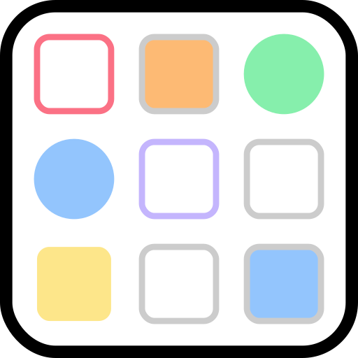

# iCloud Dashboard

Rinnovo della sessione 2FA Apple dei container iCloud di Unraid **con un solo bot Telegram**, condiviso fra più container e con il
resto della casa. Gestisce due famiglie di container:

- **📷 foto** — [boredazfcuk/icloudpd](https://github.com/boredazfcuk/docker-icloudpd) (uno per Apple ID, libreria personale o condivisa);
- **📁 iCloud Drive** — [mandarons/icloud-drive](https://github.com/mandarons/icloud-docker) (uno per Apple ID, solo download).

> Nomi precedenti: *iCloudpd-dispatcher* (fino al 22/10/2026, solo foto) e *icloud-dispatcher* (fino al 5/11/2026). GitHub reindirizza i
> vecchi nomi; dalla 3.0 l'immagine è `ghcr.io/sidimam/icloud-dashboard`, il container `icloud-dashboard`, l'appdata
> `/mnt/user/appdata/icloud-dashboard`. Il progetto per posta, calendario, contatti, note e ricerca globale è in RepoCasa
> (`docs/progetti/icloud-completo.html`).

## Il problema

Il cookie di autenticazione Apple dura circa 30 giorni. L'immagine icloudpd sa già riautenticarsi da Telegram
(`telegram_polling=true`: legge `<user> auth` e `<user> 123456` dalla chat), ma il polling di Telegram (`getUpdates` con offset)
è esclusivo: due container sullo stesso bot si rubano i messaggi. Servirebbe un bot per container.

## La soluzione

Un piccolo container, `icloud-dashboard`, è l'unico a leggere il bot. Riconosce il prefisso `#nome` e consegna il comando
al container giusto tramite il socket Docker:

| Messaggio in chat        | Effetto                                                                                  |
|--------------------------|------------------------------------------------------------------------------------------|
| `#sofia auth`            | cancella cookie+sessione di `iCloudpd-sofdimambro` e avvia `/opt/authenticate.exp` (password dal portachiavi del container); Apple invia il codice ai dispositivi dell'account |
| `#sofia 123456`          | scrive il codice in `/tmp/icloudpd/expect_input.txt` del container (expect lo attende 10 minuti) e conferma l'esito |
| `#drive-sdimambro auth`  | per un container iCloud Drive: lancia `icloud --username … --session-directory=/config/session_data` nel container (password dal keyring, salvato al primo login manuale); Apple invia il codice |
| `#drive-sdimambro 123456`| scrive il codice nella FIFO `/tmp/2fa.fifo` da cui `icloud` legge; se il login riesce (`EXIT=0` in `/tmp/2fa.log`) il container viene riavviato e riprende a scaricare |
| `#stato`                 | giorni rimanenti della sessione Apple di ogni container (foto: `DAYS_REMAINING`; Drive: scadenza reale del cookie di fiducia `X-APPLE-WEBAUTH-HSA-TRUST`, ~90 giorni, che l'app rinnova da sola finché la sessione resta viva) |
| `#sofia log`             | ultime 8 righe utili del log del container (senza gli errori innocui ripetuti a ogni giro) |
| `#sofia riavvia` / `ferma` / `avvia` | azioni rapide sul container (`docker restart/stop/start`); il riavvio fa partire subito un giro di sincronizzazione |
| `#aiuto`                 | elenco comandi                                                                           |

I container iCloudpd restano con `telegram_polling=false` e usano il bot solo per **inviare**: le loro notifiche operative (avvio, download,
«MFA re-confirmed») vanno nella chat privata dell'amministratore (`telegram_chat_id`), con titolo leggibile `notification_title=iCloud Foto di <nome>`
e `user=<nome>` così i messaggi dicono di chi si tratta. I messaggi del flusso 2FA (promemoria a 3 e 2 giorni, avvio a 1 giorno, conferme del
dispatcher) vanno invece nel **gruppo** di famiglia, dove tutti rispondono con `#nome 123456`.

Lo script `unraid/icloud_2fa_autostart.sh` (User Scripts, ogni giorno; riconosce i container dall'immagine e i nomi da `config.json`) completa il flusso: a **1 giorno** dalla scadenza avvisa
nella chat e avvia da solo la riautenticazione, così all'utente resta solo da rispondere `#nome 123456`.

## Icona dei container iCloud Drive

I container creati dalla GUI usano `assets/icloud-drive.png` (logo iCloud, 256×256 quadrato, ricavato da Wikimedia Commons), ospitata in questo repository: un'icona non quadrata viene deformata dal tab Docker di Unraid.

## Cartelle nel tab Docker di Unraid (facoltativo)

Con il plugin [FolderView3](https://github.com/chodeus/folder.view3) i container iCloud si raggruppano nel tab Docker: una cartella «iCloud Foto» con regola per nome `^iCloudpd-` e una «iCloud Drive» con `^iclouddr-`. I container creati dalla GUI del dispatcher rispettano questi prefissi (`iCloudpd-<nome>`, `iclouddr-<nome>`), quindi entrano da soli nella cartella giusta.

## Interfaccia web (porta 8787)

La GUI (Flask, nello stesso container) mostra due sezioni con intestazione — 📷 Foto iCloud (icloudpd) sopra, 📁 iCloud Drive sotto — e un riquadro per container: stato del container, giorni al rinnovo del cookie, Apple ID,
cosa scarica (libreria PrimarySync o SharedSync-…, album), cartella, chat Telegram, ultimo evento. Azioni: **Riautentica**,
**Invia codice** (alternativa a Telegram), azioni rapide **↻ Riavvia** (fa partire subito un giro), **■ Ferma**, **▶ Avvia** e **📜 Log**, **Impostazioni** (libreria, album, struttura cartelle, chat,
giorni di promemoria: aggiorna `/config/icloudpd.conf`, il template Unraid e riavvia), **Rimuovi dalla GUI**. **Nuovo utente** (dalla 2.4 solo container
📁 **iclouddr**, mandarons/icloud-drive: i container icloudpd esistenti restano gestibili ma non se ne creano più) crea cartelle, template Unraid e
container scrivendo `config.yaml`: iCloud Drive sotto `/mnt/user/documents/<Persona>/iCloud Drive` (cartelle da saltare, default `Home`),
e a scelta le foto personali (libreria `PrimarySync`, `%Y/%m`, nomi `simple`) sotto `/mnt/user/media/photos/<Persona>/iCloud/Personale`
montate su `/icloud/photos/all`; controllo ogni 30 minuti (foto ogni ora), nessuna porta pubblicata: lo stato si legge qui e la variabile
`ENV_CONFIG_FILE_PATH=/config/config.yaml` senza la quale l'immagine legge un config vuoto; poi il primo login manuale
`docker exec -it iclouddr-<nome> /bin/sh -c "su-exec abc icloud --username=<apple id> --session-directory=/config/session_data"` (password, codice, `y` al keyring).
Utenti e alias stanno in `/app/config.json`, condiviso con il bot; ogni utente ha `type` (`icloudpd` o `iclouddrive`), `container`, `label`, `chat_id` e, per iCloud Drive, `apple_id` e `person`. La GUI non ha autenticazione: tenerla in LAN o dietro un proxy.

### Log e blocchi (dalla 2.1)

Per i container iCloud Drive il riquadro mostra lo stato di ogni **giro** (Drive e Foto), ricavato dalle righe `Syncing drive...` /
`Drive synced` e `Syncing photos...` / `Photos synced` delle ultime 48 ore: «in corso dalle 17:19 (14 min) · l'ultimo è durato 55 min»
oppure «completato 18 min fa in 0 min», più l'ora dell'ultima riga di log. Un giro in corso da più del **doppio dell'ultimo giro completo**
(minimo un'ora), o nessuna riga di log da più di due intervalli di sincronizzazione, accende **⚠️ sembra bloccato**: di solito basta
**↻ Riavvia** (la sessione Apple resta valida, nessun codice). Caso reale del 3 nov 2026: un giro su un iCloud Drive con 8.500 cartelle
(libreria Calibre) è rimasto appeso quattro ore su una richiesta ad Apple, con il container acceso e nessun traffico.

**📜 Log** apre l'ultima parte del log del container (100–5000 righe) con errori in rosso e avvisi in arancione, ricerca, filtro «solo errori»,
aggiornamento automatico ogni 15 s e download del file. Per default nasconde gli errori innocui ripetuti a ogni giro (file che iCloud elenca
ma non lascia scaricare, come i database dei password manager, e foto senza versione alternativa), con il conteggio delle righe nascoste.

### Riavvio automatico dei giri bloccati (dalla 2.5)

`mandarons/icloud-drive` a volte resta appeso a metà giro su una connessione morta: nessuna riga di log, rete e CPU ferme, e non
riparte da solo. Ogni 2 minuti il dispatcher guarda i container iCloud Drive accesi con un giro in corso e li **riavvia** se:

- negli ultimi 10 minuti hanno ricevuto meno di 100 KB e usato meno di 2 s di CPU (un giro sano, anche quando non scarica niente,
  scorre le cartelle e riceve centinaia di KB al minuto), oppure
- il giro dura da più di 4 ore (o di 3 volte l'ultimo giro completo, se più lungo).

Al massimo 3 riavvii in 6 ore per container: dopo, un avviso Telegram alla chat predefinita e niente più riavvii automatici per 6 ore.
Gli interventi sono in `/app/state/autoheal.json` e nella scheda dell'utente («Riavvio automatico»). Non interviene durante una
riautenticazione né sui container fermati a mano. Variabili (facoltative): `AUTOHEAL=0` per spegnerlo, `AUTOHEAL_CHECK_S` (120),
`AUTOHEAL_IDLE_MIN` (10), `AUTOHEAL_MAX_CYCLE_H` (4), `AUTOHEAL_MAX_RESTARTS` (3).

Dalla 2.4.1 la pagina principale legge i log una sola volta per container (in parallelo, cache di 15 s): prima impiegava ~7 s.

### Notifiche (dalla 2.6)

Gli avvisi automatici del dispatcher si impostano dalle variabili del template Unraid:

| Variabile | Default | Effetto |
|---|---|---|
| `TELEGRAM_CHAT_ID` | vuoto | Chat degli avvisi automatici; vuoto = `default_chat_id` di `config.json` |
| `NOTIFY_AUTOHEAL_RESTART` | `1` | Un messaggio a ogni riavvio automatico di un iclouddr bloccato |
| `NOTIFY_AUTOHEAL_GAVE_UP` | `1` | Avviso quando un container si blocca 3 volte in 6 ore e i riavvii si sospendono |
| `NOTIFY_QUIET_HOURS` | `23:00-07:30` | In questa fascia gli avvisi si accodano (`/app/state/notify_queue.json`) e arrivano insieme in un solo messaggio alla fine; vuoto = sempre subito |

`TELEGRAM_TOKEN` e `ALLOWED_CHATS` (le chat da cui il bot accetta comandi) restano come prima. Le risposte ai comandi del bot e
della GUI non passano dalle ore silenziose: arrivano sempre subito alla chat che le ha chieste.

### Chiavi Immich per libreria, dalla scheda dell'utente (dalla 3.19)

- In **Utenti → (persona) → Immich** ci sono le librerie di foto della persona (es. Simone: *Personale* e *Famiglia*), ognuna con
  lo stato «chiave API» o «lettura diretta», e **+ Aggiungi una chiave Immich**: si sceglie la libreria e si incolla una chiave
  con il solo permesso `asset.read`, creata in Immich dall'utente proprietario di quella libreria (per *Famiglia* l'utente
  Immich «famiglia@…»). La chiave viene provata subito, mai mostrata, e salvata per libreria in `/app/state/immich.json` (600).
- La ricerca è mista: le librerie con la chiave usano l'API ufficiale di Immich (solo le foto di quella libreria), quelle senza
  la lettura diretta dell'analisi di Immich; i risultati si alternano. Anche con una sola chiave si cerca sempre in tutte le foto.
- In Amministrazione resta l'indirizzo di Immich e il riepilogo di quali librerie hanno la chiave.

### Files, viste, ordine delle schede, ora e meteo (dalla 3.18)

- Schede nell'ordine **Riepilogo, Files, Posta, Calendario, Contatti, Promemoria, Note, Foto, Utenti, 🔍**.
- **Files**: l'iCloud Drive di ogni persona come in Finder (Tutti → persona → cartelle, percorso cliccabile), con campo Cerca
  (testo completo), Filtri (nome, estensione, date, ordinamento) e le cartelle condivise in blu.
- **Selettore di vista** in ogni scheda, ricordato per scheda nel browser: Files *Elenco / Miniature / Dettagli*, Posta e
  Promemoria *Elenco / Dettagli*, Note *Elenco / Schede / Dettagli*, Contatti *Schede / Elenco / Dettagli*, Foto
  *Miniature / Miniature grandi / Dettagli* (il Calendario ha già Anno, Mese, Settimana, Giorno, Agenda).
- **Riepilogo**: ora (che scorre) e data, **meteo** attuale e dei prossimi giorni da Open-Meteo (gratuito, senza chiave;
  `WEATHER_LAT`, `WEATHER_LON`, `WEATHER_PLACE`, default la zona di casa a Roma, in cache 15 minuti).
- Contatti uniti fra più rubriche: un nome vero vince sempre su un numero di telefono.

### Descrizioni dietro la «i» e ricerca foto su tutta la famiglia (dalla 3.17)

- Le descrizioni (es. «Un utente = un container iCloud…», le spiegazioni di Amministrazione, Nuovo utente, Contatti, Calendario,
  dei moduli degli account, lo stato dell'indice nel Riepilogo) sono dietro un pulsante **i**: un clic apre il popup, un altro
  clic, un clic fuori o Esc lo chiudono. Restano in vista solo i messaggi di stato e le istruzioni dei passaggi di accesso
  (codici di recupero, codice 2FA).
- **Ricerca nelle foto**: con le **chiavi API dedicate** di Immich (una per utente Immich, solo permesso `asset.read`, in
  Amministrazione, una per riga) usa l'API ufficiale e unisce i risultati, perché ogni chiave vede solo le foto del suo utente.
  Senza chiavi legge l'analisi di Immich direttamente e in sola lettura su tutte le foto: il motore CLIP di Immich
  (`docker exec Immich … :3003/predict`, modello `IMMICH_CLIP_MODEL`, default `ViT-B-32__openai`) trasforma il testo in un
  vettore e la ricerca dei più vicini avviene nel database di Immich (`smart_search`, pgvector), ~0,5 s.

### Utenti in stile pannello iCloud (dalla 3.16)

- Dalla **3.16.1** le foto stanno in `media/photos/<persona>/<account>/<libreria>` (es. `Simone/iCloud/Famiglia`), come i
  documenti in `documents/<persona>/<account>/…`; «Nuovo utente» propone `media/photos/<Persona>/iCloud/Personale`.

- Ogni persona ha una scheda come il pannello iCloud: iniziale, nome, Apple ID, stato, azioni, **barra dello spazio sul NAS** per
  tipo (dalla misura con `du`) e la sezione **Account**: *Apple · iCloud* (iCloud Drive, Foto, Note, Promemoria, Posta, Calendario,
  Contatti) e ogni altro account collegato (*Gmail*, *Outlook*, IMAP) con i suoi servizi; per ogni servizio stato, frequenza,
  ultimo giro, conteggi e **percorsi** sul NAS (`/mnt/user/documents/<persona>/<account>/…`). Il nome del container e
  dell'immagine non compare più nei titoli (resta nelle Impostazioni della scheda).
- **Disposizione** orizzontale (schede affiancate) o verticale (una per riga, servizi su due colonne), ricordata nel browser.

### Ricerca intelligente nelle foto e informazioni (dalla 3.15)

- **Cerca cosa c'è nelle foto** (es. «sedia», «spiaggia», «cane sul divano») nella scheda Foto: la ricerca la fa **Immich**, che
  ha già analizzato con CLIP le stesse foto di `media/photos` (185.584 su 188.122 il 6/11/2026); i risultati tornano nella
  galleria della dashboard, nell'ordine di somiglianza (fino a 500), con i filtri di persona, album, anno e tipo. Si collega in
  **Amministrazione → Ricerca intelligente nelle foto (Immich)** con una chiave API creata in Immich (Impostazioni account →
  Chiavi API, permesso `asset.read`), salvata solo in `/app/state/immich.json` (600). Percorsi di Immich → indice con
  `IMMICH_PATH_MAP` (default `/external=/mnt/user/media/photos`), indirizzo con `IMMICH_URL`. Senza chiave si cerca nel nome del file.
- **ⓘ sulle miniature**: apre la foto direttamente con le informazioni. Nel visualizzatore il pannello Informazioni ha il suo
  «Chiudi» (ed Esc lo chiude per primo): si torna alla foto grande senza uscire dall'anteprima.

### Fusi orari, festività, ricerca e contatti (dalla 3.14)

- **Calendario**: a destra del selettore la data di oggi e l'ora, con il **fuso orario** (quello del dispositivo o uno scelto,
  ricordato nel browser; FullCalendar + Luxon 3.5.0 nell'immagine). Gli eventi creati in un altro fuso (`TZID`, anche i nomi di
  Outlook come «W. Europe Standard Time») ora sono alla loro ora vera: prima venivano letti come ora italiana (es. un volo da
  Londra un'ora prima). La scheda dell'evento mostra il fuso in cui è stato creato e l'ora di lì. Gli eventi si rileggono una
  volta sola all'aggiornamento (pochi secondi).
- **Festività**: il calendario pubblico di Apple delle festività italiane (`HOLIDAYS_URL`, default
  `https://calendars.icloud.com/holidays/it_it.ics`, scaricato una volta al giorno in `/app/state/holidays.ics`) è una voce a
  parte del selettore (Tutti → Famiglia → persone → Festività) e compare anche in «Tutti», con colore e casella come gli altri.
- **Campo Cerca** sempre visibile in Note, Promemoria, Posta e Calendario: testo completo dall'indice (titolo e contenuto; in
  Posta anche mittente, destinatari e allegati; in Calendario un elenco degli appuntamenti trovati in qualsiasi data, con il
  pulsante che porta il calendario a quel giorno). I Filtri restano per nome, date e ordinamento.
- **Contatti**: se il «nome visualizzato» (FN) è vuoto il nome viene dal campo N (nome e cognome; tutta la rubrica di Daniela era
  così), poi dal soprannome o dall'organizzazione; quelli senza alcun nome sono nella sezione ripiegabile «Numeri senza nome».
  Con 4 o più numeri di telefono (es. «Spam Call», 450) i numeri sono ripiegati.

### Calendari e promemoria di famiglia (dalla 3.13)

- Un calendario iCloud condiviso compare in ogni persona che lo vede, con gli stessi eventi (stesso UID). La dashboard li
  riconosce (eventi in comune per almeno metà del più piccolo) e li mostra **una volta sola**, con il nome in blu e l'elenco di chi
  lo vede; in «Tutti» niente più eventi ripetuti (es. Famiglia ×4: 4.545 eventi invece di 18.000).
- Il calendario di famiglia (nome «Famiglia» o «Family», variabile `FAMILY_NAMES`) è la voce **Famiglia** del selettore, come la
  libreria di foto condivisa: Tutti → Famiglia → persone. Nella vista di una persona il calendario di famiglia non c'è; gli altri
  condivisi (es. Liceo Socrate, Ingegneria) restano a ognuno dei membri.
- **Promemoria**: la lista di famiglia condivisa (dal modulo PIM, «condivisi») è la voce Famiglia e non compare più sotto la
  persona che la possiede. Le liste che altri condividono con una persona Apple non le espone.
- Riepilogo: gli eventi di famiglia contano sotto Famiglia, gli altri calendari condivisi una volta sola.

### Riepilogo, log e filtri (dalla 3.12)

- **Riepilogo** (pagina iniziale `/`; l'elenco dei container è passato in `/users`): riquadri con il numero di file, foto, messaggi,
  note, promemoria, eventi e contatti e lo spazio di ciascuno; quattro anelli (elementi e spazio per tipo, spazio ed elementi per
  persona; la libreria condivisa Famiglia è una voce a sé) con legenda, valori e percentuali, fette cliccabili; tabella per
  persona con i link alle schede già filtrate. Sezioni ripiegabili: **Dettagli e ultime sincronizzazioni** (per persona: stato del
  container, giorni di sessione, ultimo giro di Drive, Foto, Note, Promemoria, Posta, Calendario, Contatti, condivisi, riavvii
  automatici, link a scheda utente, log e ricerca) e **Indice di ricerca** (ultimo giro, elementi, durata ed esito di ogni sorgente).
- **Spazio su disco vero**: un ciclo a bassa priorità misura con `du` ogni 6 ore (`DISK_INTERVAL`) le cartelle iCloud di ogni
  persona (iCloud Drive, Posta, Note, Promemoria, Calendario, Contatti, account collegati) e gli album di foto (circa 3 minuti),
  in `/app/state/disk.json`; finché non c'è la prima misura lo spazio è stimato dai file indicizzati.
- **Amministrazione → Log**: log della dashboard e di ogni container iCloud con ricerca (testo o espressione regolare, evidenziata),
  livello (tutti, avvisi ed errori, solo errori), componente (Drive, Foto, PIM, posta/calendari/contatti, sessione Apple, riavvio
  automatico, indice), periodo (1 h – 7 giorni), righe, ordine, errori innocui nascosti o mostrati, aggiornamento ogni 15 s.
- **Filtri in ogni scheda** (pannello ripiegabile, si apre da solo quando un filtro è attivo): nome, estensione (Foto), intervallo
  di date (modifica, scadenza, scatto, data), ordinamento (data, nome, dimensione, organizzazione…) e ordine ascendente o
  discendente; in Calendario il filtro per titolo, luogo o calendario, in Cerca l'ordine ascendente/discendente.
- Indice della posta: salva ogni 2.000 messaggi (un riavvio non fa più ricominciare da capo) e stima la dimensione degli allegati
  dal testo codificato invece di decodificarli: circa 70 messaggi al secondo.

### Elementi condivisi in blu e filtro delle foto (dalla 3.11)

- **Condivisi in blu**: note, liste di promemoria (e i loro promemoria) ed elementi di iCloud Drive che la persona condivide con
  altri hanno il titolo in blu nelle schede Note, Promemoria, Cerca e nella scheda dell'elemento («condiviso»). L'elenco lo scrive
  il modulo PIM di iclouddr ≥ 0.2.6 in `pim-status.json` (`condivisi`) a ogni giro; il contenuto di una cartella del Drive
  condivisa è condiviso con lei. Per il Drive valgono anche le cartelle che altri condividono con la persona (es. Passwords
  di Simone vista da Daniela); per note e liste Apple espone solo quelle della persona stessa.
- **Foto**: il filtro è «Tutti, Famiglia, Simone, Daniela, Sofia, Maria»: le librerie condivise (ogni album diverso da Personale,
  es. Famiglia) sono una voce a sé, visibile a tutti; una persona mostra solo le sue foto personali. Le persone nuove compaiono da
  sole in tutte le schede appena il loro container è configurato.
- Le nuove persone create da qui usano `ghcr.io/sidimam/iclouddr:0.2.8` (`ICLOUDDR_IMAGE`).

### Foto, mappa, miniature e metadati (dalla 3.9)

- L'indice comprende le **foto e i video** che iclouddr scarica in `media/photos/<Persona>/iCloud/<album>` (Personale, Famiglia; prima del 6/11/2026 senza `iCloud/`):
  188.113 elementi in circa 90 s. Gli amministratori vedono tutte le persone, un utente solo le proprie.
- **Foto**: galleria per persona, album, anno, foto o video, 120 per pagina; visualizzatore a schermo intero (frecce, Esc, «i»
  per i metadati; HEIC mostrato come JPEG, video riprodotti dal browser). **Mappa** in stile app Foto: i punti vicini si
  raggruppano in una miniatura con il conteggio (Leaflet.markercluster 1.5.3), il clic avvicina la zona e mostra sotto la griglia
  delle foto di quel gruppo; si allarga a tutto schermo.
- **Coordinate e data di scatto**: un ciclo in background legge con exiftool (`-fast2`, priorità bassa) 400 foto ogni ~10 s
  finché non le ha lette tutte (circa 80 minuti), poi solo le nuove; la data di scatto sostituisce quella del file.
- **Miniature** con vips (JPEG, HEIC, PNG, TIFF, PDF) e ffmpeg (fotogramma dei video), in cache in `/app/state/thumbs`
  (circa 20 KB l'una); si creano al primo sguardo e un ciclo a bassa priorità le prepara tutte, dalle più recenti
  (`THUMB_WARM=0` lo spegne).
- **Riquadro Informazioni** nella scheda di ogni elemento e nel visualizzatore: tutti i metadati del file letti da exiftool
  (qualsiasi formato: foto, video, audio, PDF, Office…), raggruppati, con il link alla mappa se c'è il GPS; in cache nell'indice.

### Calendario, Posta, Contatti e anteprime (dalla 3.7)

- **Calendario**: viste anno, mese, settimana, giorno e agenda (FullCalendar 6.1.15, dentro l'immagine), tutti o una persona,
  calendari da mostrare o nascondere e colore scelto per ognuno (salvato in `settings.json`), eventi ripetuti espansi
  (`icalendar` + `recurring-ical-events` sul file .ics originale), clic → scheda dell'evento. **Mappa** (Leaflet 1.9.4, tessere
  OpenStreetMap) con i luoghi che hanno coordinate (GEO o luogo scelto da Mappe); in Amministrazione si può attivare la ricerca
  delle coordinate degli altri indirizzi con Nominatim (spenta per default; al massimo 15 per vista, una al secondo, in cache).
- **Posta**: cartelle per persona e account, messaggi in ordine di data, scheda con testo (HTML in pagina isolata, immagini remote
  bloccate), allegati da scaricare e .eml; la ricerca con tutti i filtri è nella scheda Cerca.
- **Contatti**: rubrica unica o per persona; la stessa persona salvata da più di voi (e-mail o ultime 9 cifre del telefono uguali)
  compare una volta sola, con «presente in» e le schede originali.
- **Anteprima dei file** nella scheda: immagini, PDF, video, audio e testi (fino a 200 KB); i file serviti dalla GUI hanno
  `Content-Security-Policy: sandbox` (un HTML o un SVG non può eseguire script). «Esci» anche in fondo a «Il mio profilo».

### Cerca, Note, Promemoria (dalla 3.6)

- **Indice «iclouddb»**: un file SQLite con ricerca full-text (FTS5, senza distinzione di accenti) in `/app/state/iclouddb.db`,
  dentro questo container (nessun database a parte). Ogni 15 minuti (`INDEX_INTERVAL`) rilegge i file di iCloud Drive di ogni
  persona (nome, cartella, tipo, dimensione, data), le note e i promemoria del modulo PIM e, quando ci sono, posta, eventi e contatti
  degli account collegati; rilegge solo ciò che è cambiato. Primo giro su 4 persone: 38.900 file, 69 note, 1.317 promemoria in 24 s,
  36 MB. Stato e «Reindicizza ora» nella scheda Amministrazione.
- **Cerca**: tutto o una persona, per tipo (file, note, promemoria, posta, calendario, contatti), con filtri per data, account,
  mittente, destinatari, nome dell'allegato, tipo di file, dimensione, solo con allegati; ordinamento per pertinenza, data,
  dimensione o nome. Le parole valgono come prefisso; le frasi tra virgolette restano esatte.
- **Note**: cartelle per persona e note in ordine di modifica; la nota si apre in una pagina isolata (niente script, immagini solo
  dagli allegati della nota). **Promemoria**: liste per persona, da fare/fatti/tutti, scadenze passate in rosso.
- Un utente con ruolo «Utente» vede solo i propri dati anche qui.

### Account collegati (dalla 3.5)

Nella scheda di ogni utente iclouddr (immagine `ghcr.io/sidimam/iclouddr` ≥ 0.2) la sezione **Account collegati** aggiunge uno o
più account di posta, calendari e contatti: iCloud, Gmail, Outlook o un altro IMAP. Ognuno scrive in
`documents/<Persona>/<etichetta>/{Posta,Calendario,Contatti}`, in sola lettura. Il file è `/config/pim-accounts.json` del container
(600, utente 99:100): la GUI non mostra mai le password e le sostituisce solo se ne viene scritta una nuova. «Sincronizza ora» crea
`/config/pim-run-now`. La sezione «Cosa scarica» riassume lo stato di ogni servizio per tutti gli account.

### Ruoli (dalla 3.4)

Ogni profilo è **Amministratore** (vede tutti i container, «Nuovo utente» e «Amministrazione») oppure **Utente** (vede e gestisce
solo il proprio container, quello che si chiama `iclouddr-<profilo>`, più il proprio profilo; le altre pagine rispondono 403).
Il ruolo si sceglie dalla scheda Amministrazione; il profilo `admin` resta sempre amministratore e deve restarne almeno uno.

### Aspetto, lingua e messaggi (dalla 3.2)

- Grafica nello stile delle Impostazioni di iOS/macOS: liste raggruppate, colori di sistema Apple, icone SVG proprie nello stile dei
  simboli Apple, interruttori e controlli segmentati; ogni sezione si apre e si chiude e il browser ricorda quali sono aperte.
- **Tema** sistema/chiaro/scuro e **lingua** italiano/inglese da «Il mio profilo» (o dalla pagina di accesso): salvati nel profilo e
  in un cookie. I testi sono in italiano nel codice; le traduzioni stanno in `gui/i18n_en.py` (chiave = testo italiano).
- Ogni messaggio Telegram del bot e della GUI inizia con **`ICLOUD:`** (variabile `TELEGRAM_PREFIX`), così in chat si capisce chi
  scrive: gli altri sistemi di casa usano `HOME ASSISTANT:`, `UNRAID:`, `PROXMOX:`, `UPTIME KUMA:`, `WELLNESS:`.

### Accesso con profili e 2FA (dalla 3.0)

La GUI ha un profilo **admin** e un profilo per persona (`sdimambro`, `dmanieri`, `sofdimambro`, `mdimambro`), tutti amministratori.
Stanno in `/app/state/profiles.json` (permessi 600): hash scrypt della password, segreto TOTP, ultimo accesso.

- **Primo avvio della 3.0**: l'admin conserva la password della 2.x (`/app/state/gui_password` o `GUI_PASSWORD_HASH`); i profili
  personali nascono senza password e non entrano finché un amministratore non gliela imposta dalla scheda **Amministrazione**.
- **Il mio profilo**: cambio password e verifica in due passaggi TOTP (QR da inquadrare con l'app Password dell'iPhone, Google
  Authenticator, Bitwarden o 1Password, oppure chiave da inserire a mano; per spegnerla serve la password).
- **Amministrazione** (solo amministratori): elenco dei profili con stato di password e 2FA, impostazione o reimpostazione della
  password, spegnimento del 2FA di un profilo, nuovi profili, eliminazione (non di sé stessi né dell'admin); notifiche Telegram
  (chat, avvisi di riavvio e di blocco, ore silenziose) salvate in `/app/state/settings.json` con precedenza sulle variabili del
  template, e un messaggio di prova.
- **Recupero**: all'attivazione del 2FA la GUI mostra **8 codici di recupero** monouso (formato `k7m2-x9qp`, salvati solo come hash;
  rigenerabili dal profilo con la password). In alternativa «Password dimenticata o telefono perso?» manda un codice a 6 cifre
  (10 minuti, 5 tentativi) alla **chat Telegram privata** collegata al profilo, con cui si sceglie una password nuova e/o si spegne il
  2FA. La chat la collega la persona dal suo profilo (verifica con un codice) o un amministratore. La pagina risponde sempre allo
  stesso modo, così non rivela quali profili esistono; ogni recupero e ogni accesso con codice di recupero viene segnalato alla chat
  delle notifiche.
- **Password dell'admin dimenticata o telefono perso**: compila `GUI_RESET_PASSWORD` nel template e applica: all'avvio reimposta la
  password dell'admin e gli spegne il 2FA. Poi svuota la variabile, altrimenti lo rifà a ogni riavvio (la GUI lo segnala).
- Sessione firmata con chiave persistente (`/app/state/gui_secret`), «Ricordami» 30 giorni, cookie `HttpOnly` e `SameSite=Lax`,
  10 tentativi falliti in 10 minuti per IP (password e codice 2FA insieme), `/healthz` libero per i monitor.

## Installazione (Unraid)

1. Copia `bot.sh` in `/mnt/user/appdata/icloudpd-dispatcher/bot.sh`.
2. Importa `unraid/my-iCloudpd-dispatcher.xml` in `/boot/config/plugins/dockerMan/templates-user/` e compila
   `TELEGRAM_TOKEN` e `ALLOWED_CHATS` (chat id separate da virgola: solo da queste chat vengono accettati i comandi).
3. Immagine pronta: `ghcr.io/sidimam/icloudpd-dispatcher:latest` (amd64/arm64, costruita da GitHub Actions a ogni push su main). Avvia il container con i mount del template:
   socket Docker, `/app` (config e stato), `/templates` (template Unraid), `/appdata`, `/photos`; porta 8787 per la GUI.
4. Adatta la mappa nome → container in `bot.sh` (`declare -A C=(...)`) e in `unraid/icloudpd_2fa_autostart.sh`.
5. Nei container iCloudpd: `notification_type=telegram`, `telegram_token`, `telegram_chat_id`, `telegram_polling=false`,
   `notification_days=3`. Attenzione: se il container era già inizializzato, i valori vanno cambiati anche in `/config/icloudpd.conf`,
   perché l'immagine non riscrive quelli esistenti.

## Sicurezza

- Il socket Docker dà a iCloud Dashboard il controllo dell'host: il container esegue solo `docker exec` sui nomi mappati, ma va trattato come root.
- I comandi sono accettati solo dalle chat in `ALLOWED_CHATS`; nessuno stato persistente oltre all'offset Telegram (`state/offset`).
- Il codice 2FA transita in chiaro nella chat Telegram: è monouso e vale pochi minuti.

Licenza MIT.
